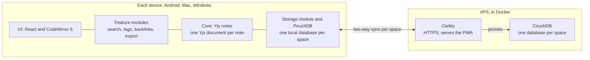

# Offline-First Notes App — PRD

Nov 2, 2026

## Overview

Build an offline-first, Obsidian-compatible notes app that syncs across Android, Mac, and Windows and supports async family collaboration. Every device keeps a full local copy, and sync must never lose anything anyone typed.

**Problem.** Off-the-shelf options either cost a subscription, need fiddly setup, or can't be extended freely. The owner wants a notes app they control, built from this spec by AI agents, that they can extend as needs grow.

**Goals**

- Work fully offline on every device, syncing automatically when online.
- Converge to identical state on every device after any sequence of offline edits, renames, and deletes.
- Read and write Obsidian-flavored Markdown so notes are never locked in.
- Support shared family spaces from day one, without a later data migration.
- Keep the codebase modular so agents can add features without touching the core.

**Non-goals for v1**

- Live co-editing with cursors (the data model must allow it later).
- End-to-end encryption (the storage layer must allow it later).
- Attachments, a public plugin API, native app wrappers, and use beyond the family.

## Users and spaces

The owner is the only user at launch; family members join later as members of shared spaces. A space is the unit of sharing, sync, and export.

- **Personal space:** every user has exactly one, private to them.
- **Shared spaces:** created by a user, with members granted access per space. Editing is async: family members edit the same notes, rarely at the same moment.
- **One database per space:** each space is its own CouchDB database, so permissions, sync, and export are all per space. Adding users later requires no migration.
- **Notes belong to one space.** Moving a note copies it into the target space and deletes the original.
- **Links stay inside a space.** Wikilinks resolve only within the note's own space.
- **Export per space:** each space exports as its own Obsidian vault.
- **Admin:** the owner creates accounts and manages space membership.

## Architecture

A single PWA runs on every device, stores everything locally in PouchDB, and replicates each space to CouchDB on one VPS. Native wrappers (Tauri, Capacitor) are added only if the PWA hits a real limit.

Notes live and merge on each device; the server only stores and relays each space's update documents.

| Layer | Choice | Notes |
| --- | --- | --- |
| Language and build | TypeScript, Vite | Strict mode on |
| UI | React | Chosen because agents write it most consistently |
| Editor | CodeMirror 6 with y-codemirror.next | Source mode in v1 |
| Collaboration data | Yjs | One Yjs document per note |
| Local storage | PouchDB on IndexedDB | One local database per space |
| Search | MiniSearch (or similar), local | Rebuilt from synced notes |
| Server | CouchDB in Docker on a VPS | One database per space |
| Web server | Caddy | HTTPS, serves the PWA and proxies CouchDB on one domain |
| Tests | Vitest, Playwright | Plus the convergence suite against a real CouchDB |

**Auth.** v1 uses CouchDB's built-in users with session cookies, and each space database lists its members in its security settings. All auth goes through an `AuthAdapter` interface. An external identity provider is added later as a new adapter plus CouchDB's JWT authentication, with no app rework.

**Encryption.** No end-to-end encryption in v1. Traffic uses HTTPS, the server is owner-controlled, and VPS backups are encrypted. Storage code must keep a single seam where per-document encryption can be added later.

**Modularity.** Features are self-contained modules behind clear interfaces (for example search, backlinks, tags, export). The core owns storage, sync, and the editor shell; feature modules never reach into PouchDB or Yjs directly.

## Data model

Every note is a Yjs document persisted as an append-only log of small update documents, so CouchDB never sees a revision conflict and Yjs does all merging.

- **Note ID:** each note has a stable, hidden ID that never changes, including across renames and folder moves.
- **Yjs document contents:** the body as a `Y.Text` holding Markdown, plus a `Y.Map` of metadata: title, folder path, tags, frontmatter, created and modified times, and a deleted flag with deletion time.
- **Update documents:** every edit batch is written as a new PouchDB document keyed by note ID, device ID, and a monotonically increasing sequence. Update documents are never modified after creation.
- **Snapshots:** on a schedule, a client writes a snapshot document containing the merged Yjs state and the set of updates it covers. Covered updates may then be compacted. Snapshots are kept from day one so version history can be built later.
- **Derived indexes:** title-to-ID maps, backlinks, tags, and the search index are derived locally from the Yjs state and never synced.
- **Space database:** holds only that space's update and snapshot documents. Database names and security settings follow the space model above.
- **Storage seam:** all reads and writes of update and snapshot documents go through one storage module, which is where encryption would be added later.

## Sync and conflict behavior

The rule above all others: after every device reconnects and sync completes, all devices hold identical state, and no text anyone typed is lost.

- **Replication:** each local space database replicates continuously and bidirectionally with its CouchDB database whenever online, and retries with backoff when offline.
- **Full copies:** every device syncs every space it belongs to in full. No partial sync in v1.
- **Concurrent edits:** handled entirely by Yjs merging; no user-visible conflict for text edits.
- **Renames:** renaming a note updates every wikilink to it within the space. Links resolve by title at render time and are rewritten by note ID, so a concurrent rename and link edit still converge.
- **Title collisions:** when two notes end up with the same title in the same folder (offline creates or renames), both are kept. The note that sorts later by a deterministic key (creation time, then note ID) gets a numeric suffix such as "Groceries 1", so every device picks the same one. The UI shows a duplicate-title badge until the user resolves it.
- **Deletes:** deleting a note sets its deleted flag and moves it to the space's trash. Sync never hard-deletes. Edits made concurrently with a delete land in the trashed copy. Trashed notes are purged after 30 days, and can be restored before then.
- **Moves between spaces:** copy to the target space with a new note ID, then delete the original into its trash.
- **Storage persistence:** on first launch the app requests persistent browser storage and shows a visible warning if it is denied.

## Markdown and Obsidian compatibility

Notes are stored as Obsidian-flavored Markdown, and anything the app doesn't understand is kept verbatim so a round trip through Obsidian loses nothing.

| Syntax | Example | v1 |
| --- | --- | --- |
| Wikilinks | `[[Note]]` | Supported |
| Wikilink aliases | `[[Note\|label]]` | Supported |
| Heading links | `[[Note#Heading]]` | Supported |
| YAML frontmatter | `---` block at top | Supported |
| Tags | `#tag`, `#parent/child` | Supported |
| Callouts | `> [!note] Title` | Supported |
| Embeds | `![[Note]]` | Phase 2, preserved as text |
| Block references | `^block-id`, `[[Note#^id]]` | Phase 2, preserved as text |

- **Organization:** notes live in folder paths. Titles are unique within a folder, matching Obsidian's file names.
- **Link resolution:** like Obsidian, a link to a title resolves to the matching note in the space, preferring the shortest path when titles repeat across folders.
- **Export:** one click exports a space as a folder of `.md` files that opens directly as an Obsidian vault, with folders and frontmatter intact.
- **Import:** importing an Obsidian vault folder is phase 2 and uses the same format as export.

## V1 features and UI

V1 delivers a complete daily-use notes app: write, link, find, and sync, on phone and desktop.

- **Editor:** CodeMirror 6 source mode with Markdown syntax styling, plus a toggle to a rendered reading view. Wikilinks autocomplete titles and are clickable in both modes.
- **Sidebar:** folder tree for the current space and a space switcher. Create, rename, move, and delete notes and folders.
- **Quick switcher:** keyboard-driven jump to any note by title, creating it if it doesn't exist.
- **Command palette:** every app action is a named command reachable by keyboard.
- **Backlinks panel:** lists notes linking to the current note, with context snippets.
- **Tags pane:** all tags in the space with counts; selecting a tag lists its notes.
- **Search:** offline full-text search over titles, bodies, tags, and frontmatter. Searches all spaces by default, with a filter for one space.
- **Trash:** per-space trash view with restore and permanent delete.
- **Sync status:** a compact indicator showing synced, syncing, offline, or error. Tapping it shows pending changes and last successful sync per space. Errors that stop sync, such as an expired session, are shown clearly with the fix.
- **Responsive layout:** on narrow screens the sidebar becomes a drawer and panels become sheets. Must be fully usable on an Android phone.
- **Installable and offline:** a service worker caches the app shell so it launches with no network.
- **Updates:** a new deploy shows an "Update available" prompt; the app never reloads on its own mid-edit.
- **Hosting:** the VPS serves the PWA's static files and CouchDB through Caddy on one domain.

## Quality gate

A convergence test suite is written before the sync code, runs against a real CouchDB in Docker in CI, and must pass on every merge.

The harness creates two or more simulated clients, each with its own PouchDB, controls when each is online, and after reconnection asserts that every client holds identical state: same notes, titles, paths, bodies, tags, trash contents, and derived links.

| # | Scenario | Expected result |
| --- | --- | --- |
| S1 | Two clients edit different parts of one note offline | Both edits present on all clients |
| S2 | Two clients edit the same line offline | Yjs merge applied identically on all clients; no text lost |
| S3 | Both clients create "Groceries" in the same folder offline | Both kept; the same one is suffixed on every client; badge shown |
| S4 | One client renames a note while another adds a link to it | Link points to the renamed note on all clients |
| S5 | Two clients rename different notes to the same title | Both kept; deterministic suffix; badge shown |
| S6 | One client deletes a note while another edits it | Note is in trash on all clients and contains the edit |
| S7 | A note is moved to another space while it is edited in the original | Original in trash with the edit; copy in target space |
| S8 | A client stays offline for many edits, then reconnects | All edits sync; state identical |
| S9 | Snapshot compaction runs while another client is offline | Offline client's later updates still merge correctly |
| S10 | A trashed note is restored on one client while edited on another | Note restored with the edit on all clients |
| S11 | Export a space and re-parse the files | Output matches the notes, with unknown syntax preserved verbatim |

Agents must not weaken or skip these tests to make code pass. New sync-affecting features add scenarios here first.

## Milestones

Work proceeds in eight epics, in order; each epic is split into tickets, and an epic starts only when the ones it depends on are done.

1. **Foundation:** repo, TypeScript, Vite, React, lint, Vitest, Playwright, CI with CouchDB in Docker, PWA shell with service worker.
2. **Convergence harness and scenarios:** multi-client test harness and scenarios S1 to S11, failing. Depends on 1.
3. **Storage and sync core:** storage module, Yjs update log, snapshots and compaction, per-space replication, title collisions, trash. Goal: S1 to S10 pass. Depends on 2.
4. **Auth and spaces:** `AuthAdapter` with the CouchDB implementation, login, personal space creation, shared spaces and membership, admin account creation. Depends on 3.
5. **Editor and navigation:** CodeMirror source mode, reading view, wikilinks with autocomplete, sidebar, quick switcher, command palette, responsive layout. Depends on 3.
6. **Linking, tags, and search:** link resolution and rename rewriting, backlinks, tags pane, frontmatter, callouts, local search. Depends on 5.
7. **Sync UX and reliability:** sync status indicator, error surfacing, persistent storage request, update prompt, trash view. Depends on 4 and 5.
8. **Export and deployment:** Obsidian vault export with S11 passing, Caddy and CouchDB deployment on the VPS, encrypted backups. Depends on 6 and 7.

## Phase 2 and later

Daily notes ship first after v1; the rest follow in roughly this order.

1. Daily notes
2. Live preview editing via CodeMirror decorations
3. Embeds and block references
4. Attachments stored in object storage, referenced from notes
5. Obsidian vault import
6. Version history UI built on existing snapshots
7. Templates
8. Graph view

Later, only if needed: live co-editing with cursors, end-to-end encryption, an external identity provider, cross-space links, native app wrappers, and a public plugin API.

